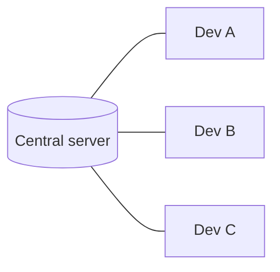
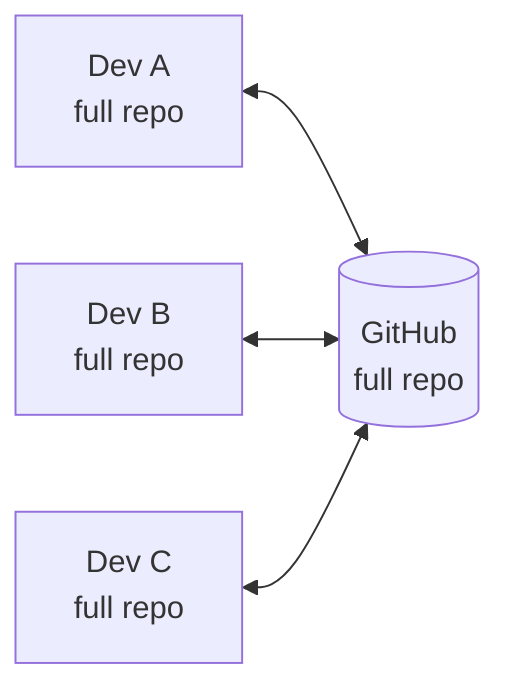

# Version Control System (VCS)

A **Version Control System** records every change you make to your files, so you can go back to any earlier
version, see who changed what, and work with other people without overwriting each other's work.

## Why do we need it?
Without version control, people save files like this:

```
report.docx
report_final.docx
report_final_v2.docx
report_final_REALLY_final.docx
```

With version control there is **one file** and a full history of every change.

## What a VCS gives you
| Benefit | Meaning |
|---|---|
| History | Every change is saved with a message, author and date |
| Undo | Go back to any previous version |
| Collaboration | Many people work on the same project at the same time |
| Branching | Try new ideas safely without breaking the main code |
| Backup | A copy of the project lives on a server (e.g. GitHub) |

## Types of VCS
1. **Local VCS** – history is kept only on one computer.
2. **Centralized VCS (CVCS)** – one central server holds the history (e.g. SVN). If the server is down, nobody can commit.
3. **Distributed VCS (DVCS)** – every developer has the **full history** on their own machine (e.g. **Git**, Mercurial).


*Centralized: everyone depends on one server.*


*Distributed (Git): everyone has a full copy.*

## Key takeaway
Git is a **distributed** version control system: you can commit, view history and create branches **offline**,
and share your work later.
