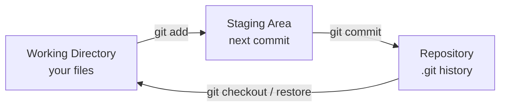

# What is Git?

**Git** is a free, open-source, distributed version control system created by **Linus Torvalds in 2005** to manage
the development of the Linux kernel. Today it is the most widely used version control tool in the world.

## Main features
- **Fast** – almost every operation runs locally
- **Distributed** – every clone is a full backup with complete history
- **Branching is cheap** – create and switch branches in milliseconds
- **Data integrity** – every commit is identified by a SHA-1 hash, so history cannot change silently
- **Staging area** – choose exactly which changes go into the next commit

## The three areas of Git

| Area | What it is |
|---|---|
| Working directory | The files you see and edit |
| Staging area (index) | A list of changes prepared for the next commit |
| Repository (`.git` folder) | The saved history of all commits |

## File states
`untracked` → `staged` → `committed` → `modified` → `staged` → `committed` …

## Git vs GitHub
**Git** is the tool on your computer. **GitHub** is a website that hosts Git repositories online.
You can use Git without GitHub, but GitHub needs Git.
