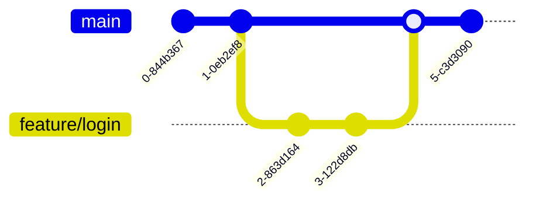

# git branch – Work in parallel

A **branch** is an independent line of development. `main` holds stable code; new work happens on other branches.



## Commands
```bash
git branch                     # list local branches (* = current)
git branch -a                  # include remote branches
git branch feature/login       # create
git switch feature/login       # switch (newer command)
git switch -c feature/login    # create + switch
git checkout -b feature/login  # same, older syntax
git branch -m old new          # rename
git branch -d feature/login    # delete (merged)
git branch -D feature/login    # force delete
```

## Naming conventions
`feature/…`, `fix/…`, `docs/…`, `hotfix/…` – lowercase with hyphens, e.g. `feature/user-profile`.

## HEAD
`HEAD` points to the branch (and commit) you are currently on.
