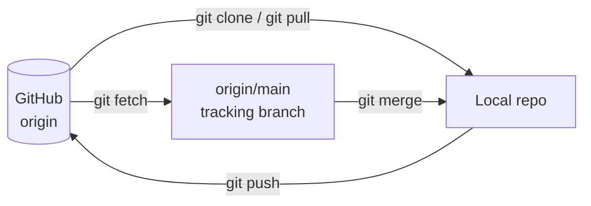

# clone, push, pull, fetch



| Command | What it does |
|---|---|
| `git clone <url>` | Download a full copy of a repository |
| `git push` | Upload your commits to the remote |
| `git push -u origin main` | First push of a branch; sets upstream |
| `git fetch` | Download new commits but **don't** change your files |
| `git pull` | `fetch` + `merge` into your current branch |
| `git pull --rebase` | `fetch` + `rebase` (cleaner history) |

## Push a new local project to GitHub
```bash
git init
git add .
git commit -m "Initial commit"
git branch -M main
git remote add origin https://github.com/<user>/<repo>.git
git push -u origin main
```

## "Rejected – fetch first"
Someone pushed before you. Run `git pull`, fix any conflicts, then `git push` again.
