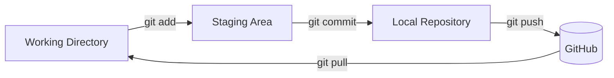

<div align="center">

# Git & GitHub Full Course

**A complete beginner-to-advanced guide to Git and GitHub — clear notes, real commands, hands-on exercises,
projects, interview questions and a cheat sheet.**


</div>

---

## 🚀 Start Here

**New to Git?** Follow the **[14-day Learning Path](LEARNING-PATH.md)** — one hour a day, read a note, type the
commands yourself, then do the matching exercise.

**Prefer offline reading?** 📄 Download the whole course as one PDF:
**[Git-GitHub-Full-Course.pdf](pdf/Git-GitHub-Full-Course.pdf)**

**Need a quick reminder?** 📋 See the **[Cheat Sheet](13-Cheat-Sheet/Git-Cheat-Sheet.md)**.

---

## 🎯 Who Is This For?
- Students and beginners who have never used Git
- Developers who use Git daily but want to understand branching, rebasing and undoing changes
- Anyone preparing for internships or job interviews
- Teams that want a shared reference for GitHub workflows

## 📚 Course Contents

| # | Section | Topics |
|---|---|---|
| 01 | **Introduction** | [Version Control](01-Introduction/Version-Control-System.md) · [What is Git](01-Introduction/What-is-Git.md) · [What is GitHub](01-Introduction/What-is-GitHub.md) |
| 02 | **Installation** | [Windows](02-Installation/Windows.md) · [macOS](02-Installation/macOS.md) · [Linux](02-Installation/Linux.md) |
| 03 | **Git Basics** | [config](03-Git-Basics/Git-Config.md) · [init](03-Git-Basics/Git-Init.md) · [status](03-Git-Basics/Git-Status.md) · [add](03-Git-Basics/Git-Add.md) · [commit](03-Git-Basics/Git-Commit.md) · [log](03-Git-Basics/Git-Log.md) · [diff](03-Git-Basics/Git-Diff.md) · [.gitignore](03-Git-Basics/Gitignore.md) |
| 04 | **Branching** | [Branches](04-Branching/Git-Branch.md) · [Merge](04-Branching/Git-Merge.md) · [Merge conflicts](04-Branching/Merge-Conflicts.md) |
| 05 | **Remote Git** | [Remotes & SSH](05-Remote-Git/Remote.md) · [clone / push / pull / fetch](05-Remote-Git/Clone-Push-Pull-Fetch.md) |
| 06 | **GitHub** | [Repositories](06-GitHub/Repository.md) · [Fork & Pull Request](06-GitHub/Fork-and-Pull-Request.md) · [Issues & Projects](06-GitHub/Issues-and-Projects.md) · [GitHub Pages](06-GitHub/GitHub-Pages.md) |
| 07 | **Advanced Git** | [Undo changes](07-Advanced-Git/Undo-Changes.md) · [Stash](07-Advanced-Git/Stash.md) · [Rebase](07-Advanced-Git/Rebase.md) · [Tags](07-Advanced-Git/Tags.md) · [Cherry-pick](07-Advanced-Git/Cherry-Pick.md) |
| 08 | **GitHub Actions** | [Introduction](08-GitHub-Actions/Introduction.md) · [First workflow](08-GitHub-Actions/First-Workflow.md) |
| 09 | **Best Practices** | [Commit messages](09-Best-Practices/Commit-Messages.md) · [Branching strategy](09-Best-Practices/Branching-Strategy.md) |
| 10 | **Interview Questions** | [Beginner](10-Interview-Questions/Beginner.md) · [Advanced](10-Interview-Questions/Advanced.md) |
| 11 | **Practice** | [16 exercises in 4 levels](11-Practice/Exercises.md) |
| 12 | **Projects** | [Portfolio with GitHub Pages](12-Projects/Project-1.md) · [Team collaboration](12-Projects/Project-2-Team-Collaboration.md) |
| 13 | **Cheat Sheet** | [All commands on one page](13-Cheat-Sheet/Git-Cheat-Sheet.md) |

## 🔄 The Git Workflow in One Picture



## ⚡ Quick Start (5 minutes)

```bash
git config --global user.name "Your Name"
git config --global user.email "you@example.com"

mkdir hello-git && cd hello-git
git init
echo "# Hello Git" > README.md
git add README.md
git commit -m "docs: add README"

git branch -M main
git remote add origin https://github.com/<username>/hello-git.git
git push -u origin main
```

## 🗂️ Repository Structure

```
git-github-full-course/
├── 01-Introduction/ … 13-Cheat-Sheet/   # numbered course sections
├── LEARNING-PATH.md                     # 14-day plan for beginners
├── pdf/Git-GitHub-Full-Course.pdf       # whole course in one PDF
├── scripts/build_pdf.sh                 # rebuild the PDF (pandoc + wkhtmltopdf)
├── .github/workflows/                   # example GitHub Actions workflow
├── CONTRIBUTING.md
├── CHANGELOG.md
└── LICENSE
```

## 🤝 Contributing
Found a mistake or want to add a topic (e.g. `git bisect`, submodules)? See [CONTRIBUTING.md](CONTRIBUTING.md).
Changes are listed in the [CHANGELOG](CHANGELOG.md).

## 📜 License
Released under the [MIT License](LICENSE).

## 👤 Author
**Md Feroz Ahmed** — CSE, Pundra University of Science & Technology · [GitHub](https://github.com/feroz-afm)

⭐ If this course helped you, give the repository a star!
